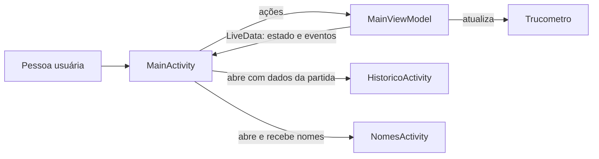

# Trucômetro

Aplicativo Android para marcar pontos de partidas de truco. A interface oferece
atalhos para os valores de pontuação, identifica o vencedor ao atingir 12 pontos
e mantém a contagem de partidas ganhas durante o uso do app.

## Funcionalidades

- Soma de **1, 3, 6, 9 ou 12 pontos** para cada jogador.
- Alerta de vitória ao atingir 12 pontos ou mais; após confirmar, a pontuação da
  rodada é zerada e a vitória permanece contabilizada.
- Ação de desfazer a última pontuação.
- Edição dos nomes das equipes, com limite de 16 caracteres.
- Tela de resumo das vitórias e opção para zerar os dados da partida.
- Interface em português, com componentes Material e feedback visual.

> **Armazenamento:** nomes, pontuações e vitórias são mantidos em memória
> enquanto o processo do app está ativo; não há banco de dados ou sincronização.
> A ação **Zerar Histórico** limpa vitórias e pontuações e restaura os nomes
> padrão.

## Arquitetura

O projeto usa uma organização leve baseada em **MVVM**. As Activities cuidam da
interface e navegação, enquanto o `MainViewModel` concentra as regras da
pontuação e publica o estado com `LiveData`. A classe `Trucometro` representa os
dados atuais do jogo.



### Organização do código

```text
app/src/
├── main/
│   ├── java/dev/fernandojose/trucometro/
│   │   ├── model/       # Estado da partida e valores de pontuação
│   │   ├── view/        # Activities, navegação e extensões visuais
│   │   └── viewmodel/   # Regras de jogo e estado observável
│   └── res/             # Layouts, strings, cores, estilos e ícones
├── test/                # Testes unitários do ViewModel
└── androidTest/         # Testes instrumentados da interface
```

### Fluxo de pontuação

1. A pessoa toca em um botão de pontuação de uma das equipes.
2. `MainActivity` encaminha a equipe e o valor ao `MainViewModel`.
3. O ViewModel atualiza o modelo e emite um evento de vitória quando a equipe
   chega a 12 pontos ou mais.
4. A Activity apresenta um alerta. Ao confirmá-lo, o ViewModel zera os pontos da
   rodada sem apagar nomes ou vitórias.

## Tecnologias

- Kotlin e Android SDK.
- AndroidX `ViewModel` e `LiveData`.
- View Binding para acesso às views.
- Material Components para os componentes de interface.
- JUnit e AndroidX Arch Core Testing nos testes unitários; Espresso nos testes
  instrumentados.
- Gradle com Version Catalog para centralizar versões das dependências.

## Requisitos

- JDK 21 para o Gradle.
- Android SDK com a plataforma **API 37**.
- Dispositivo ou emulador Android API 24 ou superior para executar o app.

## Executar

Clone o repositório, abra-o no Android Studio e permita que o Gradle sincronize
as dependências. Também é possível compilar pela linha de comando:

```bash
bash ./gradlew assembleDebug
```

No Windows:

```powershell
.\gradlew.bat assembleDebug
```

## Testes e qualidade

Executar os testes unitários:

```bash
bash ./gradlew :app:testDebugUnitTest
```

Executar os testes instrumentados em um dispositivo ou emulador conectado:

```bash
bash ./gradlew :app:connectedDebugAndroidTest
```

Executar as verificações usadas pela CI:

```bash
bash ./gradlew spotlessCheck :app:detekt :app:lintDebug :app:testDebugUnitTest --continue
```

Para formatar os arquivos Kotlin e Gradle:

```bash
bash ./gradlew spotlessApply
```

Os relatórios ficam em `app/build/reports/` e `build/reports/`. O GitHub Actions
executa as verificações de qualidade em pushes e pull requests e publica os
relatórios como artefato.

### Hooks locais

Instale os hooks explicitamente com `bash ./gradlew installGitHooks`. A tarefa copia
os scripts de `.githooks` para `.git/hooks` sem substituir hooks existentes. Se
já houver algum hook, revise-o e integre manualmente o script correspondente.
Repositórios que usam `core.hooksPath` ou um arquivo `.git` (worktrees) precisam
instalar os scripts manualmente no diretório de hooks ativo.

O pre-commit verifica a formatação, sem modificar ou adicionar arquivos ao
índice; o commit-msg verifica a primeira linha da mensagem no padrão
Conventional Commits; e o pre-push executa as verificações de qualidade. As
verificações usam os arquivos atuais do diretório de trabalho, não apenas os
arquivos no índice ou nos commits sendo enviados.
